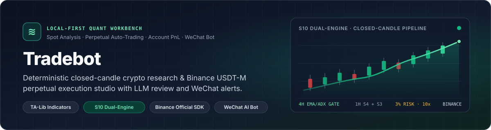
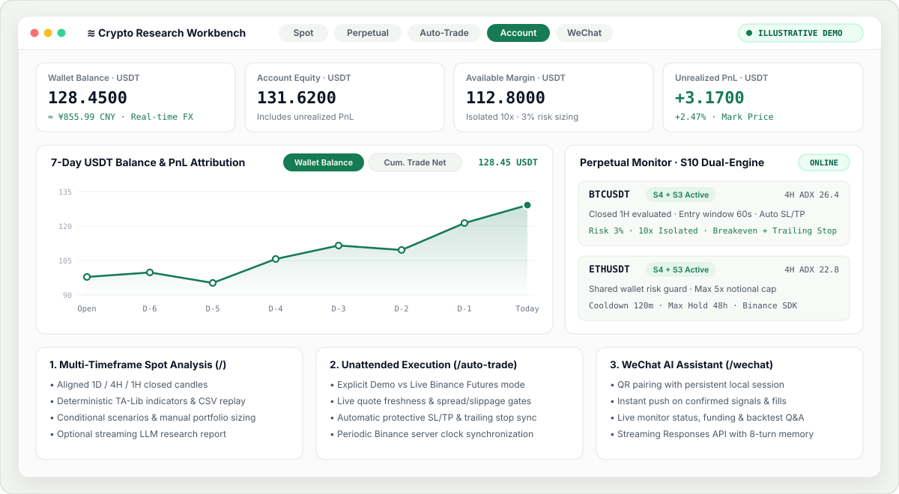
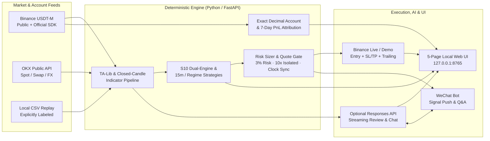
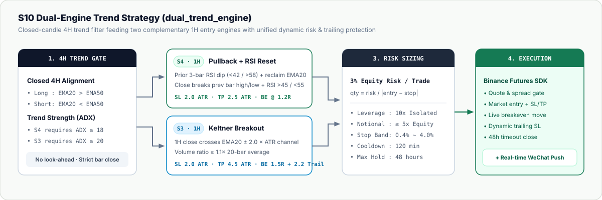

<div align="center">



<br />
<br />

**English** · [简体中文](README.zh-CN.md)

<br />

[](pyproject.toml)
[](src/spot_agent/api.py)
[](src/spot_agent/technicals.py)
[](docs/binance-futures.md)
[](#security--risk-boundaries)

<p align="center">
  A local-first cryptocurrency spot research and Binance USDT-M perpetual auto-trading workbench.<br />
  Built around strict closed-candle determinism, the <strong>S10 Dual-Engine</strong> trend strategy, real-time account PnL attribution, optional LLM review, and a WeChat AI assistant.
</p>

[Features](#-workbench-overview) · [Architecture](#-system-architecture) · [S10 Strategy](#-s10-dual-engine-strategy) · [Quick Start](#-quick-start) · [Configuration](#-configuration) · [Documentation](#-documentation)

</div>

---

## ✨ Why Tradebot?

Most retail trading bots blur indicator math with LLM guesses, evaluate repainting candles mid-bar, or silently fall back to mock data when an exchange call fails. **Tradebot** enforces hard engineering boundaries:

- **Strict Closed-Candle Determinism** — Every official signal is computed exclusively on bars closed before the cutoff timestamp using deterministic `TA-Lib` / NumPy math. No repainting, no look-ahead bias.
- **No Silent Fallbacks** — Live public market feeds, synthetic demo data, and historical CSV replays are explicitly separated and labeled. If an exchange endpoint or ledger slice is unavailable or truncated, the UI reports it plainly instead of fabricating numbers.
- **Auditable Risk & Execution** — Live Binance USDT-M execution is opt-in via process environment variables (`BINANCE_FUTURES_MODE=demo|live`), enforces server clock sync, spread/quote freshness gates, isolated margin, automatic protective SL/TP orders, breakeven shifts, and trailing stops.
- **Local-First Privacy** — Binds exclusively to `127.0.0.1`. API keys, account credentials, live market state, and personal positions never enter Git or frontend bundles.

---

## 🖥️ Workbench Overview

<div align="center">
  
  <sub><em>Illustrative preview with synthetic demo balances — covers the unified 5-page local web interface.</em></sub>
</div>

<br />

| Workspace | Route | Key Capabilities |
| :--- | :--- | :--- |
| **Spot Research** | `/` | Synchronized `1D / 4H / 1H` closed-candle technical reports, conditional market scenarios, CSV historical replay, manual portfolio sizing, Markdown export, and optional streaming LLM deep analysis. |
| **Perpetual Monitor** | `/perpetual` | Independent `BTC-USDT-SWAP` and `ETH-USDT-SWAP` background monitors supporting **S10 Dual-Engine**, `15m` Range Breakout, Trend Pullback, and Compression strategies with live quote & cost verification. |
| **Auto-Trade Console** | `/static/auto-trade.html` | End-to-end unattended Binance USDT-M workflow visibility: active execution mode (`off / demo / live`), strategy status, protective SL/TP management, breakeven/trailing state, and execution audit log. |
| **Account & Analytics** | `/account` | Real-time Binance USDT-M wallet balance, equity, available margin, unrealized PnL with live `USD/CNY` conversion, margin & shock-scenario calculator, open positions, and an interactive **7-Day Balance & Cumulative Trade Net Curve** reconstructed with exact `Decimal` ledger math. |
| **WeChat AI Assistant** | `/wechat` | QR-code pairing with persistent local session, automatic push notifications for confirmed signals and live order events, and an interactive AI assistant (8-turn session memory) that queries live monitor status, funding rates, spot/perpetual comparisons, and local backtests. |

---

## 🏗️ System Architecture



---

## 🎯 S10 Dual-Engine Strategy

The flagship **`dual_trend_engine` (S10)** strategy combines two complementary closed-candle `1H` entry engines under a shared `4H` trend filter, designed to capture both trend pullbacks and volatility expansions while strictly capping per-trade risk.

<div align="center">
  
</div>

<br />

| Parameter | S4 — 1H Pullback + RSI Reset | S3 — 1H Keltner Breakout |
| :--- | :--- | :--- |
| **Higher-TF Gate** | Closed `4H` `EMA20` vs `EMA50`, `ADX ≥ 18` | Closed `4H` `EMA20` vs `EMA50`, `ADX ≥ 20` |
| **Entry Trigger (1H)** | Prior 3-bar RSI dip (`<42` long / `>58` short), close reclaims `EMA20`, breaks prior bar high/low, RSI `>45` / `<55` | `1H` close breaks `EMA20 ± 2.0 × ATR` Keltner Channel with volume ratio `≥ 1.1×` |
| **Stop Loss / Take Profit** | `2.0 × ATR` SL · `2.5 × ATR` TP | `2.0 × ATR` SL · `4.5 × ATR` TP |
| **Active Protection** | Move SL to breakeven at `+1.2R` | Move SL to breakeven at `+1.5R` + `2.2 × ATR` trailing stop |
| **Risk & Limits** | `3%` equity risk/trade · `10×` isolated · `≤ 5×` notional cap · `0.4%–4.0%` stop band · `120m` cooldown · `48h` max hold | Same unified portfolio risk guard |

> [!NOTE]
> Historical backtest and live paper-trading reports are reproducible from public exchange data. Backtest performance reflects specific historical windows and fill assumptions and does not guarantee future returns.

---

## 🚀 Quick Start

### Prerequisites

- **Python 3.12 or 3.13** (3.13 recommended to match `requirements.lock.txt`)
- Windows PowerShell (for `start.ps1`) or any OS with `uvicorn`
- Optional: OpenAI-compatible Responses API credentials (for LLM deep analysis & WeChat chat)
- Optional: Binance USDT-M Futures API keys (only required for `demo` or `live` execution / `/account`)

### 1. Clone & Install

```powershell
git clone https://github.com/yuzigewmy/tradebot.git
cd tradebot

python -m venv .venv
.\.venv\Scripts\python.exe -m pip install -r requirements.lock.txt
.\.venv\Scripts\python.exe -m pip install -e . --no-deps
```

### 2. Configure Environment

```powershell
Copy-Item .env.example .env
# Edit .env with your optional LLM gateway and Binance mode settings
```

### 3. Launch the Workbench

```powershell
# Default local research & signal mode (binds 127.0.0.1:8765)
.\start.ps1

# Custom port
.\start.ps1 -Port 8766

# Live Binance execution mode (explicitly loads .env.binance-live with override)
.\start.ps1 -Port 8765 -Live

# Run silently in the background on Windows (logs written to logs/)
.\start.ps1 -Port 8765 -Live -Background
```

On macOS / Linux, launch directly via `uvicorn`:

```bash
.venv/bin/python -m uvicorn spot_agent.api:app --host 127.0.0.1 --port 8765 --env-file .env
```

Open **`http://127.0.0.1:8765`** in your browser.

---

## ⚙️ Configuration

All credentials are read strictly from process environment variables (`.env` for standard startup, `.env.binance-live` when launching with `-Live`).

| Variable | Default | Description |
| :--- | :--- | :--- |
| `BINANCE_FUTURES_MODE` | `off` | Execution mode: `off` (signals only), `demo` (Binance Futures Testnet/Demo), or `live` (real funds). |
| `BINANCE_FUTURES_API_KEY` | — | Binance Futures API key (required for `demo` / `live` and `/account`). |
| `BINANCE_FUTURES_API_SECRET` | — | Binance Futures API secret. |
| `SPOT_LLM_BASE_URL` | — | Optional OpenAI-compatible Responses API endpoint URL. Without it, all deterministic features remain fully usable. |
| `SPOT_LLM_API_KEY` | — | API key for the LLM endpoint (`store: false` is sent on requests). |
| `SPOT_LLM_MODEL` | `gpt-6.2-sol` | Model identifier used for spot deep review, perpetual review, and WeChat assistant. |
| `SPOT_LLM_REASONING_EFFORT` | `high` | Reasoning effort sent to the Responses API. |
| `SPOT_LLM_SERVICE_TIER` | — | Optional service tier (the UI reports the actual tier returned by the gateway). |
| `SPOT_LLM_ACTOR_AUTHORIZATION` | — | Optional actor authorization header if required by a custom gateway. |

---

## 🧪 Testing & Backtesting

Run the unit test suite:

```powershell
.\.venv\Scripts\python.exe -m pytest -q
```

Key targeted suites:

```powershell
# S10 Dual-Engine strategy & bracket math
.\.venv\Scripts\python.exe -m pytest -q tests/test_perpetual_dual.py

# Binance Futures execution, clock sync, and order protection
.\.venv\Scripts\python.exe -m pytest -q tests/test_binance_futures.py

# Account wallet snapshot & 7-day balance curve reconstruction
.\.venv\Scripts\python.exe -m pytest -q tests/test_account_api.py

# WeChat bridge & assistant context routing
.\.venv\Scripts\python.exe -m pytest -q tests/test_wechat.py
```

For full historical replay, funding-fee accounting, and live paper-trading commands, see [docs/perpetual-backtest.md](docs/perpetual-backtest.md).

---

## 📁 Project Structure

<details>
<summary><strong>Click to expand directory tree</strong></summary>

```text
crypto-spot-agent/
├── src/spot_agent/
│   ├── api.py                   # FastAPI application & route wiring
│   ├── market.py / technicals.py# Closed-candle spot data & TA-Lib indicators
│   ├── strategy.py / portfolio.py / report.py
│   ├── agent.py                 # Streaming Responses API deep research agent
│   ├── perpetual_dual.py        # S10 Dual-Engine (S4 Pullback + S3 Keltner)
│   ├── perpetual_strategy.py    # 15m / Regime strategies & policy evaluation
│   ├── perpetual_monitor.py     # Background perpetual monitors & signal journal
│   ├── perpetual_backtest.py    # Historical replay & live paper-trading engine
│   ├── binance_sdk.py           # Official Binance USDT-M SDK wrapper & clock sync
│   ├── binance_execution.py     # Order placement, protective SL/TP & trailing stop
│   ├── binance_monitor.py       # Binance perpetual monitor bridge
│   ├── account_api.py           # Wallet snapshot, FX rate & 7-day PnL/balance curve
│   └── wechat_*.py              # QR pairing, signal push & AI assistant bridge
├── web/                         # Native zero-build 5-page web UI (HTML/CSS/JS)
├── skills/perpetual-entry/      # Strategy policy JSON & LLM review prompts
├── prompts/                     # Editable WeChat assistant system prompt
├── docs/                        # Research notes, backtest specs & visual assets
├── tests/                       # Pytest unit & integration suites
└── start.ps1                    # Local & live Windows launcher script
```

</details>

---

## 📚 Documentation

- [Binance Futures Auto-Trading Guide](docs/binance-futures.md) — API permissions, Demo vs Live setup, and acceptance checks
- [Perpetual Strategy V2 Upgrade](docs/perpetual-v2.md) — Multi-timeframe structure, modes, and review flow
- [Perpetual Backtest & Live Paper Trading](docs/perpetual-backtest.md) — Reproducible backtest CLI, fill assumptions, and data boundaries
- [Regime Research Notes](docs/perpetual-regime-research.md) — Market regime diagnostics and strategy comparisons
- [Spot Implementation Plan](docs/implementation-plan.md) & [Research Notes](docs/research.md)
- [15m Strategy Policy](skills/perpetual-entry/15m-policy.json) · [15m Review Prompt](skills/perpetual-entry/15m-review.md) · [WeChat Assistant Prompt](prompts/wechat-assistant.md)

---

## 🔒 Security & Risk Boundaries

> [!WARNING]
> **Cryptocurrency perpetual futures involve substantial financial risk and leverage.** Always verify strategy behavior in signal-only (`off`) or Binance `demo` mode before enabling `live` trading. You are solely responsible for your API keys, capital allocation, and live execution decisions.

> [!IMPORTANT]
> - Keep `.env`, `.env.binance-live`, `data/`, and `logs/` out of version control (already excluded by `.gitignore`).
> - Restrict Binance API keys to **Futures trading only** without withdrawal permissions, and bind your static IP whenever possible.
> - Ensure your host system clock is synchronized (NTP) before running live signed Binance requests.
