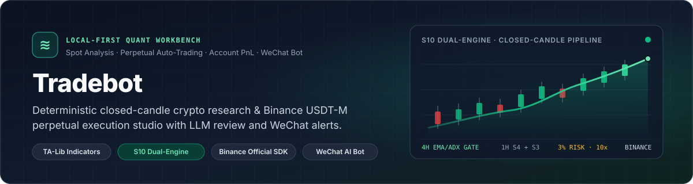
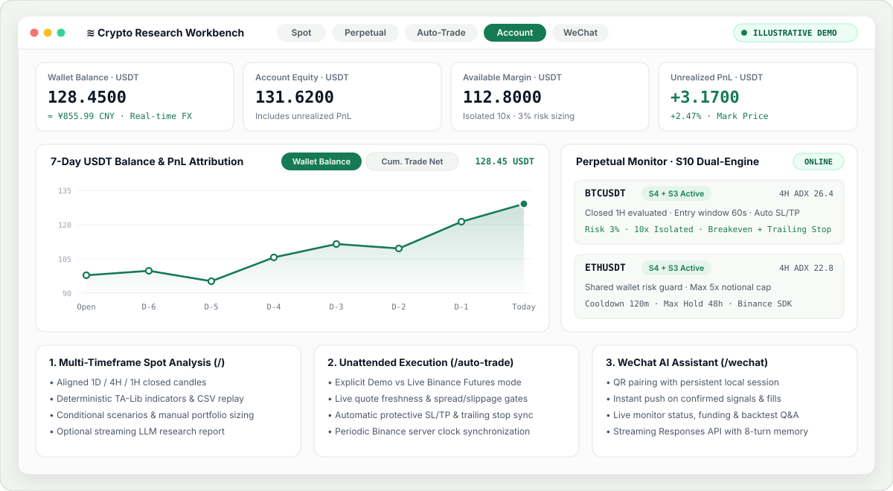
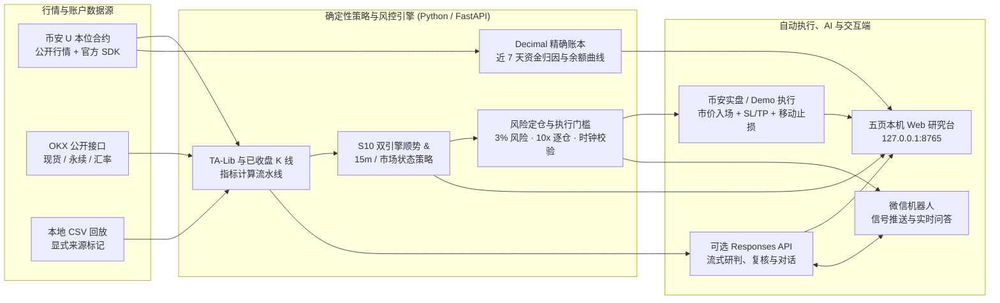
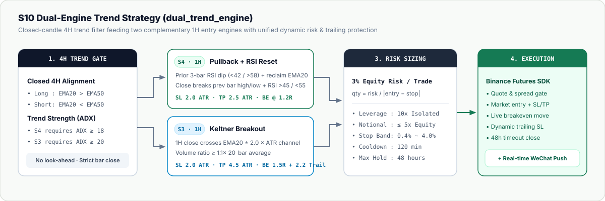

<div align="center">



<br />
<br />

[English](README.md) · **简体中文**

<br />

[](pyproject.toml)
[](src/spot_agent/api.py)
[](src/spot_agent/technicals.py)
[](docs/binance-futures.md)
[](#安全与风险边界)

<p align="center">
  本机优先的加密货币现货研判与币安 U 本位永续自动交易研究台。<br />
  坚持严格已收盘 K 线确定性指标、<strong>S10 双引擎顺势策略</strong>、精确账户资金归因、可选流式 LLM 复核与微信 AI 助手联动。
</p>

[功能总览](#-研究台总览) · [系统架构](#-系统架构) · [S10 双引擎策略](#-s10-双引擎顺势策略) · [快速开始](#-快速开始) · [环境变量](#-配置说明) · [相关文档](#-文档索引)

</div>

---

## ✨ 核心设计原则

很多个人交易脚本容易把指标计算和模型猜测混在一起、盘中使用未收盘 K 线导致信号闪烁，或在行情接口异常时静默降级为假数据。**Tradebot** 在工程上设定了清晰边界：

- **严格已收盘 K 线与确定性指标** — 所有正式信号只使用截止时点已收盘的 K 线，技术指标全部由 `TA-Lib` / NumPy 确定性代码计算，杜绝未来函数与盘中闪烁。
- **拒绝静默兜底** — 真实交易所行情、合成演示数据与本地 CSV 历史回放明确区隔并清晰标记；若行情接口失败或流水达到截断上限，页面直接提示缺失，不伪造数据或资金曲线。
- **可审计的风控与实盘执行** — 币安 U 本位自动下单需通过环境变量显式开启（`BINANCE_FUTURES_MODE=demo|live`），内置交易所时钟校对、盘口新鲜度与点差/成本门槛、逐仓保证金、自动挂保护性止损/止盈单、保本上移与动态移动止损。
- **本机优先与凭据隔离** — 服务仅监听 `127.0.0.1`。密钥、账户凭据、模型原始会话日志、实时行情与个人持仓均不进入 Git 或前端代码。

---

## 🖥️ 研究台总览

<div align="center">
  
  <sub><em>界面结构示意（图中为合成演示数值）——涵盖五页一体化本机 Web 研究台。</em></sub>
</div>

<br />

| 页面模块 | 访问路径 | 核心能力 |
| :--- | :--- | :--- |
| **现货研判** | `/` | 按同一截止时间同步分析 `1D / 4H / 1H` 已收盘 K 线，输出技术报告、条件情景、CSV 历史回放、手工持仓风险评估、Markdown 导出，以及可选的流式 LLM 深度研判。 |
| **永续合约监控** | `/perpetual` | 独立启停 `BTC-USDT-SWAP` 与 `ETH-USDT-SWAP` 后台监控，支持 **S10 双引擎顺势**、`15m` 区间突破、趋势回踩及压缩突破策略，并在发布前复验盘口报价与交易成本。 |
| **自动开单控制台** | `/static/auto-trade.html` | 透明展示无人值守币安 U 本位合约执行链路：当前模式（`off / demo / live`）、策略运行状态、保护性止损/止盈、保本与移动止损跟踪、订单执行记录。 |
| **账户与资金归因** | `/account` | 实时读取币安 U 本位钱包余额、账户权益、可用余额与未实现盈亏并附带实时 `USD/CNY` 汇率换算；提供保证金预算、持仓情景压力测算，以及基于精确 `Decimal` 流水倒推的 **近 7 天钱包余额 / 累计交易净额交互折线图**。 |
| **微信 AI 助手** | `/wechat` | 手机扫码配对并持久化本机绑定；自动推送确认后的永续信号与实盘成交状态；支持私聊随时查询监控在线状态、自动下单详情、BTC/ETH 走势对比、资金费率与本地回测结果（保留最近 8 轮对话上下文）。 |

---

## 🏗️ 系统架构



---

## 🎯 S10 双引擎顺势策略

主推策略 **`dual_trend_engine`（S10）** 以 `4H` 已收盘趋势作为统一方向闸门，在 `1H` 周期上并联两套互补入场引擎——同时覆盖「顺势回调低吸」与「放量通道突破」，并由统一的风险定仓与移动止损模块护航。

<div align="center">
  
</div>

<br />

| 规则维度 | S4 — 1H 趋势回踩 + RSI 重置 | S3 — 1H Keltner 通道突破 |
| :--- | :--- | :--- |
| **大周期趋势闸门** | 已收盘 `4H` `EMA20` vs `EMA50`，要求 `ADX ≥ 18` | 已收盘 `4H` `EMA20` vs `EMA50`，要求 `ADX ≥ 20` |
| **1H 入场触发** | 前 3 根 K 线 RSI 回踩（多 `<42` / 空 `>58`），收盘重回 `EMA20` 之上/下、突破前一根高/低点且 RSI 恢复（`>45` / `<55`） | `1H` 收盘突破 `EMA20 ± 2.0 × ATR` Keltner 通道，且量比 `≥ 1.1×` |
| **止损 / 止盈** | `2.0 × ATR` 止损 · `2.5 × ATR` 止盈 | `2.0 × ATR` 止损 · `4.5 × ATR` 止盈 |
| **盘中动态保护** | 浮盈达 `+1.2R` 时止损移至保本 | 浮盈达 `+1.5R` 时移至保本 + `2.2 × ATR` 动态移动止损 |
| **仓位与风控约束** | 单笔止损风险 `3%` · `10×` 逐仓 · 名义额上限 `5×` 权益 · 止损幅度 `0.4%–4.0%` · 冷却 `120 分钟` · 最长持仓 `48 小时` | 共享同一账户级风控约束 |

> [!NOTE]
> 历史回测与实时模拟均基于公开交易所行情与显式撮合假设复现，历史样本表现不代表未来实盘收益。

---

## 🚀 快速开始

### 环境要求

- **Python 3.12 或 3.13**（推荐 3.13，与 `requirements.lock.txt` 保持一致）
- Windows PowerShell（使用 `start.ps1` 一键启动）或任意支持 `uvicorn` 的平台
- 可选：兼容 Responses API 的 LLM 服务凭据（用于深度研判、信号复核与微信对话）
- 可选：币安 U 本位合约 API 密钥（仅 `demo` / `live` 下单与 `/account` 账户页需要）

### 1. 克隆仓库并安装依赖

```powershell
git clone https://github.com/yuzigewmy/tradebot.git
cd tradebot

python -m venv .venv
.\.venv\Scripts\python.exe -m pip install -r requirements.lock.txt
.\.venv\Scripts\python.exe -m pip install -e . --no-deps
```

### 2. 配置环境变量

```powershell
Copy-Item .env.example .env
# 按需填写模型网关与币安运行模式
```

### 3. 启动研究台

```powershell
# 默认本机研究与信号模式（监听 127.0.0.1:8765）
.\start.ps1

# 指定其他端口
.\start.ps1 -Port 8766

# 币安实盘自动交易模式（显式加载并覆盖 .env.binance-live）
.\start.ps1 -Port 8765 -Live

# Windows 静默后台启动（日志输出到 logs/ 目录）
.\start.ps1 -Port 8765 -Live -Background
```

macOS / Linux 环境可直接通过 `uvicorn` 启动：

```bash
.venv/bin/python -m uvicorn spot_agent.api:app --host 127.0.0.1 --port 8765 --env-file .env
```

启动后在浏览器访问 **`http://127.0.0.1:8765`**。

---

## ⚙️ 配置说明

所有凭据仅从进程环境变量读取（普通启动加载 `.env`，`-Live` 模式显式以 `.env.binance-live` 覆盖）。

| 环境变量 | 默认值 | 说明 |
| :--- | :--- | :--- |
| `BINANCE_FUTURES_MODE` | `off` | 执行模式：`off`（仅信号）、`demo`（币安合约模拟盘）、`live`（币安实盘）。 |
| `BINANCE_FUTURES_API_KEY` | — | 币安合约 API Key（`demo` / `live` 与 `/account` 页面所需）。 |
| `BINANCE_FUTURES_API_SECRET` | — | 币安合约 API Secret。 |
| `SPOT_LLM_BASE_URL` | — | 可选 Responses API 网关地址；不配置时全部确定性指标与策略功能仍可正常使用。 |
| `SPOT_LLM_API_KEY` | — | 模型网关密钥（请求默认携带 `store: false`）。 |
| `SPOT_LLM_MODEL` | `gpt-6.2-sol` | 现货深度研判、永续复核与微信助手使用的模型名称。 |
| `SPOT_LLM_REASONING_EFFORT` | `high` | 推理强度参数。 |
| `SPOT_LLM_SERVICE_TIER` | — | 可选服务档位（页面按网关实际返回档位展示，不虚标加速）。 |
| `SPOT_LLM_ACTOR_AUTHORIZATION` | — | 自定义网关所需的额外鉴权头（如无需求留空）。 |

---

## 🧪 测试与回测

运行全量测试：

```powershell
.\.venv\Scripts\python.exe -m pytest -q
```

常用分模块验证命令：

```powershell
# S10 双引擎策略与止损/止盈边界测试
.\.venv\Scripts\python.exe -m pytest -q tests/test_perpetual_dual.py

# 币安合约执行、时钟校验与保护单测试
.\.venv\Scripts\python.exe -m pytest -q tests/test_binance_futures.py

# 账户快照与近 7 天资金变化曲线倒推测试
.\.venv\Scripts\python.exe -m pytest -q tests/test_account_api.py

# 微信桥接与助手状态上下文测试
.\.venv\Scripts\python.exe -m pytest -q tests/test_wechat.py
```

历史回测、资金费率结算与实时模拟账户运行方式见 [永续回测与实时模拟文档](docs/perpetual-backtest.md)。

---

## 📁 项目结构

<details>
<summary><strong>点击展开目录结构</strong></summary>

```text
crypto-spot-agent/
├── src/spot_agent/
│   ├── api.py                   # FastAPI 应用入口与路由聚合
│   ├── market.py / technicals.py# 已收盘现货行情抓取与 TA-Lib 指标计算
│   ├── strategy.py / portfolio.py / report.py
│   ├── agent.py                 # 流式 Responses API 深度研判代理
│   ├── perpetual_dual.py        # S10 双引擎顺势策略（S4 回踩 + S3 突破）
│   ├── perpetual_strategy.py    # 15m 与多状态永续策略评估
│   ├── perpetual_monitor.py     # 永续后台监控与信号日志
│   ├── perpetual_backtest.py    # 历史回测与实时模拟引擎
│   ├── binance_sdk.py           # 币安官方 U 本位 SDK 封装与时钟同步
│   ├── binance_execution.py     # 自动下单、保护性止损/止盈与移动止损
│   ├── binance_monitor.py       # 币安永续监控桥接
│   ├── account_api.py           # 账户快照、实时汇率与近 7 天余额折线数据
│   └── wechat_*.py              # 微信扫码配对、信号推送与 AI 助手桥接
├── web/                         # 原生零构建五页前端界面（HTML/CSS/JS）
├── skills/perpetual-entry/      # 策略参数 JSON 与模型复核提示词
├── prompts/                     # 可热更新的微信助手系统提示词
├── docs/                        # 策略调研、回测说明与图示资源
├── tests/                       # Pytest 单元与集成测试
└── start.ps1                    # Windows 本地与实盘启动脚本
```

</details>

---

## 📚 文档索引

- [币安永续自动下单配置与验收](docs/binance-futures.md) — API 权限说明、Demo/实盘配置与验收步骤
- [永续策略 V2 升级说明](docs/perpetual-v2.md) — 多周期结构、监控模式与复核流程
- [永续回测与实时模拟](docs/perpetual-backtest.md) — 回测复跑命令、撮合假设与数据边界
- [永续市场状态调研记录](docs/perpetual-regime-research.md) — 策略对比与样本诊断
- [现货实施方案](docs/implementation-plan.md) · [调研记录](docs/research.md)
- [15m 策略参数](skills/perpetual-entry/15m-policy.json) · [15m 复核提示词](skills/perpetual-entry/15m-review.md) · [微信助手提示词](prompts/wechat-assistant.md)

---

## 🔒 安全与风险边界

> [!WARNING]
> **加密货币永续合约具有高波动与杠杆强平风险。** 启用实盘自动下单前，请务必先在信号模式（`off`）或币安模拟盘（`demo`）完成验证。使用者需自行承担 API 密钥保管、仓位管理与实盘盈亏责任。

> [!IMPORTANT]
> - `.env`、`.env.binance-live`、`data/` 与 `logs/` 已被 `.gitignore` 忽略，严禁将密钥、运行行情或个人持仓提交到 Git。
> - 币安 API Key 请仅勾选**合约交易权限**，严禁开启提现权限，并建议绑定可信出口 IP。
> - 启动实盘前请确保本机系统时间已开启 NTP 自动同步，避免超出币安签名时间窗口。
