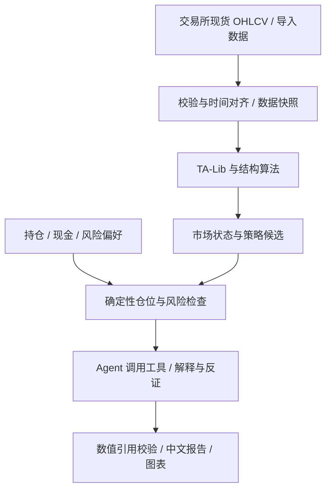

# 加密货币现货技术分析 Agent：GitHub 调研与建议方案

调研日期：2026-11-18。本文是研究与产品方案，尚未实现或运行交易系统。

## 1. 判断与建议

**事实**：OHLCV K 线可以复核趋势、动量、波动和成交量变化，但不能独立证明新闻影响、主动买卖方向、主力意图或链上资金流。技术指标和图形形态本身不构成盈利证据。

**推理**：适合本需求的产品，是能够调用量化工具、逐项解释证据、结合实际持仓给出条件化行动方案的分析 Agent。数值计算、时间对齐、仓位与风险限额由确定性程序负责，语言模型负责工具调度、解释、反证和交互。

**风险**：最容易造成错误结论的是未收盘数据、跨周期前视、指标预热不足、回测成本遗漏、形态事后确认、参数过拟合，以及把不完整的账户余额当成完整持仓成本。方案将这些作为功能约束。

建议技术组合：**Python + CCXT + TA-Lib + 结构化规则与风控 + 工具调用型 LLM + 本地分析页面**。回测阶段优先评估 MIT 许可的 Jesse，借鉴 Freqtrade 的前视与递归偏差检查。首版只选一个回测引擎，适配能力通过最小验证后确定。

默认范围：现货、无杠杆、中文报告；先覆盖 BTC/USDT、ETH/USDT；1D/4H/1H 为主要分析周期，15m 为可选观察周期；支持手动录入持仓。交易所、报价币、风险参数均可配置。这些是建议默认值，不是用户已确认的交易偏好。

## 2. GitHub 项目调研

星数取自本次读取的 GitHub 官方仓库页面嵌入数据，会随时间变化。匿名 REST API 返回 403 限流，未取得 `pushed_at`；下文维护日期指默认分支最新提交日期。GitHub 搜索页面也触发限流，因此这是主流候选的定向筛选，不声称覆盖全部项目或构成全站排名。

此次核对了官方页面、README、相关文档与关键源码，未安装运行这些项目，未验证其收益、性能或宣传指标。

| 项目 | 本次 Stars | 许可证 | 学到的能力及适配判断 |
|---|---:|---|---|
| [Freqtrade](https://github.com/freqtrade/freqtrade) | 56,996 | GPL-3.0 | 加密策略、指标、回测、dry-run；重点学习计算与信号分层、前视和递归偏差检查。完整中文研究报告需另建。 |
| [CCXT](https://github.com/ccxt/ccxt) | 44,908 | MIT | 统一交易所行情与账户接口；适合作为数据接入层，但仍需处理市场类型、分页、限频、缺口和未收盘 K 线。 |
| [TA-Lib Python](https://github.com/TA-Lib/ta-lib-python) | 12,418 | BSD-2-Clause | 技术指标和 K 线形态的可复算实现；适合作为计算底座，需要管理预热、NaN 和参数定义。 |
| [TradingAgents](https://github.com/TauricResearch/TradingAgents) | 122,973 | Apache-2.0 | 工具驱动分析、分析师协作、多空与风险研究。当前支持 BTC-USD/ETH-USD 等 Yahoo 行情，但不能等同指定交易所现货交易对。 |
| [ai-hedge-fund](https://github.com/virattt/ai-hedge-fund) | 64,736 | MIT | 信号、仓位、风险、账本与执行分层；当前代码含股票交易日与纽约时区假设，必须改为加密市场 24×7 语义。 |
| [Jesse](https://github.com/jesse-ai/jesse) | 8,818 | MIT | 多周期、多品种研究与回测，Research API/MCP 工具流程值得借鉴；现货与合约策略接口存在差异。 |
| [Hummingbot](https://github.com/hummingbot/hummingbot) | 21,247 | Apache-2.0 | 连接器、订单生命周期与执行器；适合后续执行阶段参考。做市和高频能力与首版趋势报告的关联较弱。 |
| [vectorbt](https://github.com/polakowo/vectorbt) | 9,878 | Apache-2.0 + Commons Clause | 参数与组合研究有价值；许可证附加条款限制以其功能为主要价值的收费产品或服务，不能按普通 Apache-2.0 处理。 |
| [FinRL](https://github.com/AI4Finance-Foundation/FinRL) | 17,117 | MIT | 强化学习环境与训练工作流参考；当前 README 定位经典教育/研究框架，解释性与训练成本不利于首版目标。 |

另核对了 [FinRobot](https://github.com/AI4Finance-Foundation/FinRobot)（8,445 Stars，Apache-2.0）、[ta](https://github.com/bukosabino/ta)（5,258 Stars，MIT）、[backtesting.py](https://github.com/kernc/backtesting.py)（9,255 Stars，AGPL-3.0）和 [LangGraph](https://github.com/langchain-ai/langgraph)（45,083 Stars，MIT）。它们分别可参考报告计算溯源、纯 Python 指标、回测、状态化工作流；首版按实际需要选择依赖。

已核验的维护迹象：Freqtrade develop 和 Jesse master 最新提交为 2026-11-17；TradingAgents main 为 2026-11-04；ai-hedge-fund main 为 2026-11-09；Hummingbot master 为 2026-09-22；FinRL master 为 2026-10-25。上述仓库页面均未标记归档。提交日期不代表质量认证。

### 从源码得到的具体设计依据

1. Freqtrade 的 [`sample_strategy.py`](https://github.com/freqtrade/freqtrade/blob/develop/freqtrade/templates/sample_strategy.py) 将 `populate_indicators` 与入场、出场规则分开；示例使用 TA-Lib，且 `can_short=False`。采用这种可复算的指标与规则分层。
2. Freqtrade 的 [`lookahead-analysis`](https://github.com/freqtrade/freqtrade/blob/develop/docs/lookahead-analysis.md) 比较基准与切片回测，检查指标和交易变化；[`recursive-analysis`](https://github.com/freqtrade/freqtrade/blob/develop/docs/recursive-analysis.md) 检查不同历史长度下的末端指标差异。采用对应的时间截断与预热稳定性检查思想。
3. TradingAgents 的 [`market_analyst.py`](https://github.com/TauricResearch/TradingAgents/blob/main/tradingagents/agents/analysts/market_analyst.py) 要求互补指标并通过 `get_verified_market_snapshot` 核对精确数值。采用“报告引用已验证快照”的方法；其新闻、公司基本面路径需另做加密适配。
4. ai-hedge-fund 的 [`risk/limits.py`](https://github.com/virattt/ai-hedge-fund/blob/main/hedge_fund/risk/limits.py) 规定 LLM 给信号、代码执行限额；[`pipeline/stages.py`](https://github.com/virattt/ai-hedge-fund/blob/main/hedge_fund/pipeline/stages.py) 区分分析与执行时间。采用确定性风控及截止时间视图。当前内部 README 仍含演进中的 v2 说明，复用时应锁定提交并核对接口。
5. Hummingbot 的 [`bollinger_v1.py`](https://github.com/hummingbot/hummingbot/blob/master/controllers/directional_trading/bollinger_v1.py) 从 candles 计算布林带后生成信号；[`TripleBarrierConfig`](https://github.com/hummingbot/hummingbot/blob/master/hummingbot/strategy_v2/executors/position_executor/data_types.py) 管理止损、止盈、超时和跟踪止损。执行器应独立于叙述层，其 short 信号不能原样用于现货。
6. Jesse 的 [`Strategy.py`](https://github.com/jesse-ai/jesse/blob/master/jesse/strategies/Strategy.py) 对现货在 `go_long()` 直接设置止盈/止损有明确限制，建议放在 `on_open_position()`。必须验证实际现货接口，不能直接照搬合约策略。
7. CCXT 的 [OHLCV 手册](https://github.com/ccxt/ccxt/wiki/Manual#ohlcv-candlestick-charts) 明确提示缺失周期、历史查询上限、当前 K 线未完成及延迟；TA-Lib [README](https://github.com/TA-Lib/ta-lib-python) 说明指标有各自预热长度，不能把 NaN 填成有效信号。
8. FinRL 的 [`env_multiple_crypto.py`](https://github.com/AI4Finance-Foundation/FinRL/blob/master/finrl/meta/env_cryptocurrency_trading/env_multiple_crypto.py) 有现金与持仓约束，但 [`env_btc_ccxt.py`](https://github.com/AI4Finance-Foundation/FinRL/blob/master/finrl/meta/env_cryptocurrency_trading/env_btc_ccxt.py) 的卖出逻辑可能形成负持仓。标为 crypto 不意味着全部环境都是无杠杆现货。

实际采用第三方代码前锁定版本和许可证。Freqtrade 的 GPL、backtesting.py 的 AGPL，以及 vectorbt 的 Commons Clause 需按具体分发或服务方式核实义务；不能凭“GitHub 开源”就认定可任意闭源商用。

## 3. 必须实现的详细 K 线分析

| 维度 | 首批计算与规则 | 报告需要回答的问题 |
|---|---|---|
| 市场结构 | 已确认的高低点、HH/HL/LH/LL、区间、突破和回踩 | 当前是上升、下降、震荡还是结构不明确？最近改变结构的位置在哪里？ |
| 趋势与强度 | EMA20/50/200、斜率、价格偏离、ADX14 | 趋势方向与强度怎样？偏离是否过大？适合追随还是等待回踩？ |
| 动量 | RSI14、MACD12/26/9；背离使用已确认拐点 | 动量加强还是衰减？超买超卖是否与趋势冲突？背离是否得到价格确认？ |
| 波动 | ATR14、ATR/价格、布林带20/2及带宽 | 波动扩张还是收缩？建议止损距离是否小于正常噪声？ |
| 成交量 | 同交易所量比、放量条件、OBV变化 | 突破有没有成交量配合？量价是否背离？不把它写成主力净流入。 |
| 关键价区 | 历史摆动高低点聚类、区间上下沿、前高前低 | 支撑阻力是哪些价区？距离多远？突破和失守怎样定义？ |
| K 线形态 | 实体/影线比例、吞没、锤头、十字；结合位置与量能 | 形态是否发生在有意义的价区？何时成立、何时失效？ |
| 多周期关系 | 1D方向、4H结构、1H触发，15m可选 | 各周期一致还是冲突？若日线下跌、4H反弹，应怎样限制新增仓位？ |
| 相对强弱 | 与同交易所 BTC 或配置基准比较的收益与相关性 | 目标币是相对强势，还是仅随市场一起反弹？ |

这些是分析维度，不是要求把所有指标同时投票。EMA 与 MACD 等相关指标不能重复累计成独立证据。规则给出可解释的“证据强/中/弱”，无校准样本时不输出上涨概率或胜率。

技术指标默认参数必须展示并可配置。报告按“计算事实 → 解释 → 反证 → 确认条件/失效条件”组织，避免仅列指标数值或只给买卖口号。

OHLCV 不足以得到精确成交 VWAP、成交顺序、真实成交量价位分布或盘口冲击。需要这些能力时接入逐笔成交/订单簿；若用 K 线近似，必须标注近似方法和误差边界。

## 4. Agent 工作流与数据契约

建议用一条状态明确的工具工作流开始；需要持久任务、人工介入、恢复等能力时再引入 LangGraph。技术、策略、持仓和风险是职责划分，不要求各自都运行一个 LLM。

主要工具契约：

- `load_candles`：指定交易所、现货交易对、周期、截止时间和范围；返回数据快照 ID、完整性与新鲜度。
- `compute_technicals`：输入快照与参数，返回指标数值、结构、预热状态和每项首次可用时间。
- `build_scenarios`：输入市场状态与已计算证据，返回条件化策略候选和失效条件。
- `assess_portfolio`：输入持仓、成本完整性、现金和风险参数，返回敞口、可操作数量及限制原因。
- `evaluate_strategy`：后续回测工具，输入规则版本、历史范围和成本假设，返回可保存的评估结果 ID。
- `render_report`：生成图表、中文说明及逐项数值引用，返回报告 ID。

所有工具使用有类型的输入输出；缺数、数据过期、参数不满足、风险超限要返回明确状态，不悄悄改用别的交易所或周期。LLM 不持有交易密钥。

关键数据规则：

1. 唯一标识包含交易所、现货市场类型、base/quote、周期与开盘时间。保留原始响应与标准化版本；统一 UTC 存储，页面显示明确时区。
2. 校验排序、重复、时间间隔、OHLC 范围和非负成交量。缺口要区分无成交、交易所缺失和采集故障；插补值不得冒充真实成交。
3. 显式分页获取历史、复用限频实例、失败有界重试；市场精度、最小下单额等元数据单独保存。
4. 收盘状态结合交易所时间与完成标记判断。正式信号只使用已收盘 K 线，实时未收盘变化可作为独立观察区展示。
5. 1H 时点只能使用当时已收盘的 4H、1D 数据。需要右侧 N 根确认的拐点，信号可用时间延后 N 根，不能回填至拐点发生时。
6. 指标预热长度由算法要求与稳定性检查确定。数据不足时跳过相关判断，不用 0 填充、不强行生成 EMA200 或背离结论。
7. 保存快照 ID、截止时间、参数、计算代码版本、规则版本和模型版本。相同快照与参数产生相同数值；LLM 文字可变化，但结论必须引用同一证据。
8. 对关键数值采用模板或结构化引用，并检查自然语言与引用一致性。任何价格、指标、比例或回测指标都必须有来源；失败时降级展示原始结构化结果。

## 5. 策略与持仓分析

第一批策略候选：

| 市场状态 | 策略候选 | 需给出的条件与边界 |
|---|---|---|
| 上升趋势 | 趋势回踩 | 回踩区域、结构保持条件、恢复动量触发、失效价区、费用后风险收益比。 |
| 区间突破 | 放量突破后回踩 | 突破须收盘确认；量能、回踩守稳与假突破条件参数化，不默认突破必追。 |
| 明确震荡 | 区间均值回归 | 上下沿、低趋势强度、区间失效条件；失效后不能继续机械补仓。 |
| 下跌或高波动 | 减少敞口 / 等待 | 现货卖出受实际可用持币量限制；现金也是有效配置。 |

输出持有、等待、条件买入、减仓或退出建议，并写清触发条件。持仓模式先支持手动录入币种、数量、可用数量、平均成本与现金，后续接只读账户接口和成交历史。

**余额不等于成本基础。** 转账、历史成交缺失和币种手续费都会改变成本；成本不全时盈亏与回本价显示未知，仍可分析当前敞口。不能用今天的余额与价格倒推出历史成本。

持仓分析覆盖：单币权重、BTC/ETH 等共同风险、未实现盈亏（成本完整时）、距失效位的估计损失、账户剩余风险预算、分批进出后的现金与权重。单币上限、总风险和可接受回撤由用户配置，不能擅自当作其风险偏好。

对新的现货多头，设计划入场价为 E、失效退出参考价为 S，且 E>S：

`新增数量上限 = min(剩余风险预算 / 每币估计损失, 可用现金可买数量, 单币权重剩余额度可买数量)`

其中每币估计损失包含 E−S、双边手续费与滑点假设；剩余风险预算先扣已有持仓的风险占用；现金项留出买入费用。数量按交易所精度向下取整，再检查最小数量/金额。E≤S 或预算不足时拒绝用此常规公式。卖出不得超过可用持币量。

止损价只是规划和估计风险的依据，不能保证最大亏损；流动性不足、跳价、交易所故障可能导致更差成交。未来实盘阶段需明确账户级风险限额、紧急停止与订单状态核对。

## 6. 报告与页面交付

建议首版为一个本地分析页面：K 线主图叠加 EMA、支撑阻力价区和结构点；成交量、RSI、MACD 等作为可选副图；旁边展示中文结论及证据引用；持仓输入和条件情景单独展示。可使用轻量 Python 页面和 Plotly，避免为第一版先建设复杂前端。

每份报告至少包含：

1. **数据范围**：交易所/现货交易对、周期、最新已收盘时间、数据新鲜度与完整性。
2. **核心判断**：市场状态、证据强弱、当前主要矛盾；包括是否适合新增仓位。
3. **详细技术分析**：结构、趋势、动量、波动、量能、关键价区及多周期冲突。
4. **上行/横盘/下行情景**：各自触发条件、确认方式、失效条件和观察重点；不强制分配虚构概率。
5. **持仓建议**：持有、等待、增减仓的条件、数量约束、现金和风险变化；缺持仓时只给通用情景。
6. **反证与限制**：哪些证据不支持当前判断，哪些新增数据会改变结论。
7. **可追溯信息**：快照、参数、计算/规则版本及回测证据（若存在）。

典型交互：“分析 BTC/USDT 的日线、4H 与1H结构，指出矛盾和关键价区”“我持有这些现货，按配置的风险预算评估回踩加仓和失守减仓”“复盘昨天报告的触发条件是否发生”。这些功能只依赖明确工具与数据，不要求 agent 每次任意搜索网络。

## 7. 回测与必要验证

收益评估必须先固定策略规则，再做历史验证。MVP 的分析质量与策略是否有统计优势是两项验收。

- 按时间划分开发、验证与一次性最终测试期；参数仅由对应训练窗口选择，再做滚动样本外验证。不同币种与牛、熊、震荡、高波动阶段分别报告。
- 信号必须先可用，成交假设晚于信号可用时间；通常按下一根开盘加成本建模，不能用本根最终收盘信息假装更早成交。
- 计双边手续费、点差/滑点、下单精度、最小金额、现金和持币限制。同根 K 线同时触及止盈止损时采用保守顺序或更细粒度数据，并披露假设；不能自动取有利路径。
- 比较扣费后的买入持有和持现金基准；报告收益、最大回撤、收益回撤比、交易次数、换手、手续费占比及不同阶段表现。胜率不能单独证明策略有效。
- 历史币池按当时可交易状态处理；只选今天仍存活的热门币会产生幸存者偏差。未覆盖下架币时必须注明。
- LLM 历史回放也限制数据截止时间；模型预训练可能记住历史事件，因此核心策略绩效先由确定性规则验证。LLM 解释质量单独评估，不把已知历史的叙述当作可交易收益证据。

仅做直接相关的必要检查：固定快照的指标数值对照、截断未来数据后历史信号不变、不同预热窗口稳定性、跨周期时间对齐、现货现金/数量约束，以及报告关键数值与工具结果一致。随后用模拟账本观察执行差异，持续时间以覆盖足够信号和市场条件为准，不能承诺几天就证明盈利。

## 8. 分阶段实施与验收

| 阶段 | 交付物 | 验收标准 | 依赖 |
|---|---|---|---|
| A：单币完整分析 | 单交易所 BTC/ETH 数据、指标、图表、中文报告 | 一条请求产生完整报告；所有关键数值可追溯；缺口、未收盘、预热不足被正确处理。 | 确定交易所和独立项目目录 |
| B：策略与持仓 | 市场状态、三类策略候选、手动持仓与风险计算 | 输出触发/失效条件；多周期冲突明确；新增数量满足现金/风险/权重约束，卖出不超持仓。 | A 的数据与计算契约 |
| C：历史研究 | 选定一个引擎、回放、样本外评估、报告归档 | 无已知前视，费用齐全，可复现；与持币/现金基准比较，完整披露失败区间。 | A；策略规则由 B 固定 |
| D：持续观察 | 关注列表、收盘后刷新、条件提醒、模拟账本 | 同一条件不重复提醒，过期数据停用，模拟状态与账本可核对。 | B；C 的有效性结论用于候选筛选 |
| 后续可选：实盘 | 独立执行服务、人工确认、订单状态管理 | 先完成交易权限、现货约束、限额、幂等、超时状态核对与紧急停止的专项验证。 | 模拟结果及明确执行需求 |

阶段 A 的数据契约确定后，指标/结构计算与报告层可并行；阶段 B 的持仓计算与页面可按既定契约并行。实体机器人与本项目无依赖，本轮方案文件存放在独立产物目录。

本轮不虚构尚不存在的启动、构建或测试命令；正式实施时在独立仓库锁定 Python/依赖版本，再补充可执行命令、最小测试样本与中文分阶段提交。当前只是方案，不需要在机器人仓库创建工程或安装依赖。

## 9. 成本、边界与待选配置

主要持续成本是行情维护、数据归档和 LLM 调用。K 线变化由程序持续处理，收盘后或条件变化时才生成报告；按快照、参数和规则版本缓存，避免每次刷新把全部原始 K 线送给多个模型。

调用费用按实际模型价格核算：`报告数 ×（平均输入 token × 输入单价 + 平均输出 token × 输出单价）`，另计有条件触发的复核调用。数据接口的历史范围、频率与网络可用性需按所选交易所验证；深度历史或订单簿数据可能增加获取与存储成本。没有部署规模与模型选择，当前不给无依据的金额或工期承诺。

进入实现前应收敛四项配置：交易所与报价币；主要持仓周期；分析/模拟/实盘目标；个人使用还是计划对外提供收费服务。它们影响数据适配、周期、风控与许可证选择，但不阻碍本方案的研究结论。

建议先完成 A+B，形成能详细说明“为什么、什么条件成立、何时失效、对已有持仓有何影响”的分析产品，再通过 C 判断策略是否具有样本外优势。
